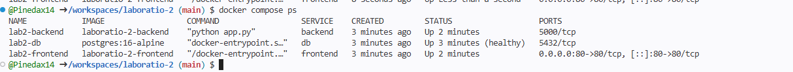
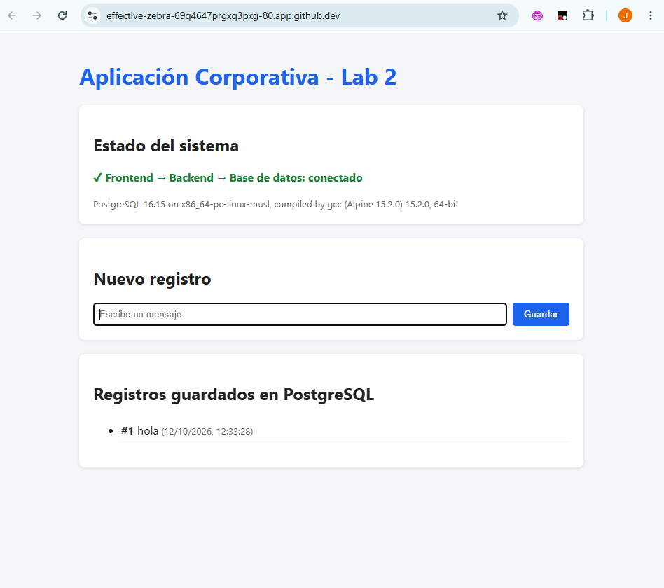
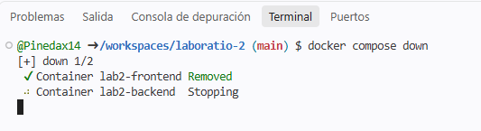
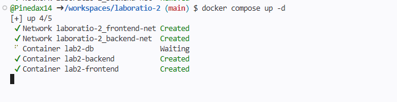
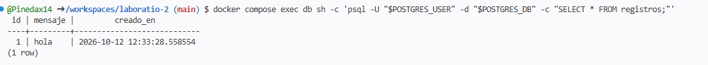
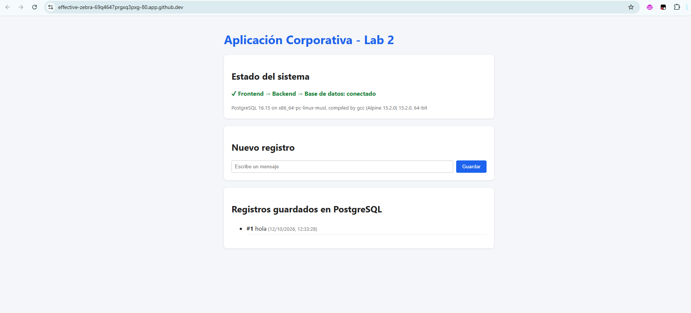
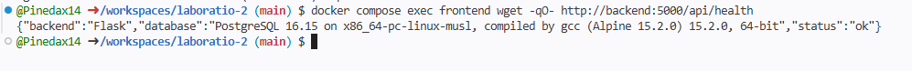

# Laboratorio 2: Despliegue y Redes de una Arquitectura Multi-Servicio con Docker Compose

**Estudiante:** _(tu nombre)_
**Asignatura:** Ingeniería de Sistemas / DevOps con Docker

## 1. Arquitectura

La aplicación tiene tres servicios, separados en dos redes bridge personalizadas:

```
        Navegador (host)
              │  http://localhost:80
              ▼
   ┌─────────────────────┐
   │  frontend (Nginx)   │
   └──────────┬──────────┘
              │  frontend-net   (proxy /api/* → backend:5000)
   ┌──────────▼──────────┐
   │  backend (Flask)    │   ← único servicio en AMBAS redes
   └──────────┬──────────┘
              │  backend-net    (backend → db:5432)
   ┌──────────▼──────────┐
   │  db (PostgreSQL 16) │ ── volumen nombrado: db-data
   └─────────────────────┘
```

| Servicio   | Imagen / Build        | Redes                     | Puerto expuesto al host |
|------------|-----------------------|---------------------------|-------------------------|
| `frontend` | `./frontend` (Nginx)  | `frontend-net`            | `80:80`                 |
| `backend`  | `./backend` (Flask)   | `frontend-net`, `backend-net` | ninguno             |
| `db`       | `postgres:16-alpine`  | `backend-net`             | ninguno                 |

**Comunicación:**
- El navegador solo llega al **frontend** por el puerto 80.
- Nginx sirve la página estática y reenvía las peticiones `/api/*` al **backend** por `frontend-net`, usando el nombre del servicio (`http://backend:5000`) como DNS interno.
- El backend se conecta a **PostgreSQL** por `backend-net` (`db:5432`).
- **Aislamiento:** el frontend no está en `backend-net`, así que no puede resolver ni alcanzar el contenedor `db`. La base de datos tampoco publica puertos en el host.

**Persistencia:** los datos de PostgreSQL se guardan en el volumen nombrado `db-data` (montado en `/var/lib/postgresql/data`). Ese volumen sobrevive a `docker compose down`.

**Credenciales:** el usuario, la contraseña y el nombre de la BD se leen del archivo `.env`, que no se sube al repositorio. `docker-compose.yml` solo hace referencia a las variables (`${POSTGRES_USER}`, etc.). El archivo `.env.example` sirve de plantilla.

### API del backend

| Método | Ruta              | Descripción                                   |
|--------|-------------------|-----------------------------------------------|
| GET    | `/api/health`     | Estado del backend y versión de PostgreSQL    |
| GET    | `/api/registros`  | Lista los registros guardados                 |
| POST   | `/api/registros`  | Crea un registro `{"mensaje": "texto"}`       |

## 2. Instrucciones de ejecución

**Requisitos:** Docker Desktop instalado y en ejecución.

```bash
# 1. Crear el archivo de variables de entorno a partir de la plantilla
cp .env.example .env          # En PowerShell: Copy-Item .env.example .env
# (editar .env y poner credenciales propias)

# 2. Construir y levantar el entorno en segundo plano
docker compose up -d --build

# 3. Verificar los servicios
docker compose ps

# 4. Abrir en el navegador
#    http://localhost

# 5. Ver logs (opcional)
docker compose logs -f backend

# 6. Apagar limpiamente (conserva los datos del volumen)
docker compose down

# 7. Apagar Y borrar los datos (solo si se quiere reiniciar desde cero)
docker compose down -v
```

### Verificar el aislamiento de redes

```bash
docker network ls
docker network inspect nombre-estudiante-lab2_frontend-net
docker network inspect nombre-estudiante-lab2_backend-net

# El frontend NO puede resolver la base de datos (debe fallar):
docker compose exec frontend ping -c 2 db

# El frontend SÍ alcanza al backend:
docker compose exec frontend wget -qO- http://backend:5000/api/health
```

## 3. Evidencias

### 3.1 Servicios en ejecución (`docker compose ps`)



### 3.2 Persistencia de datos tras `down` / `up -d`

Procedimiento:
1. Abrir `http://localhost` y crear uno o varios registros.
2. Ejecutar `docker compose down`.
3. Ejecutar `docker compose up -d`.
4. Recargar `http://localhost`: los registros siguen ahí.

También se puede comprobar directamente en la base de datos:
```bash
docker compose exec db sh -c 'psql -U "$POSTGRES_USER" -d "$POSTGRES_DB" -c "SELECT * FROM registros;"'
```

**Antes del `down`:** el registro `#1 hola` ya estaba guardado (ver captura de la sección 3.3).







### 3.3 Frontend comunicándose con el backend

La página muestra "✔ Frontend → Backend → Base de datos: conectado" junto con la versión de PostgreSQL que devuelve el backend.


### 3.4 Aislamiento de redes (adicional)

El frontend **no** puede resolver el nombre `db` porque no pertenece a `backend-net`:


El frontend **sí** alcanza al backend a través de `frontend-net`:



## Estructura del proyecto

```
nombre-estudiante-lab2/
├── .env.example          # Plantilla de variables (sin contraseñas reales)
├── .gitignore            # Excluye .env del repositorio
├── docker-compose.yml    # Orquestación: 3 servicios, 2 redes, 1 volumen
├── backend/
│   ├── Dockerfile
│   ├── app.py            # API Flask
│   └── requirements.txt
├── frontend/
│   ├── Dockerfile
│   ├── nginx.conf        # Sirve estáticos y hace proxy de /api al backend
│   └── index.html
├── evidencias/           # Capturas de pantalla
└── README.md
```
